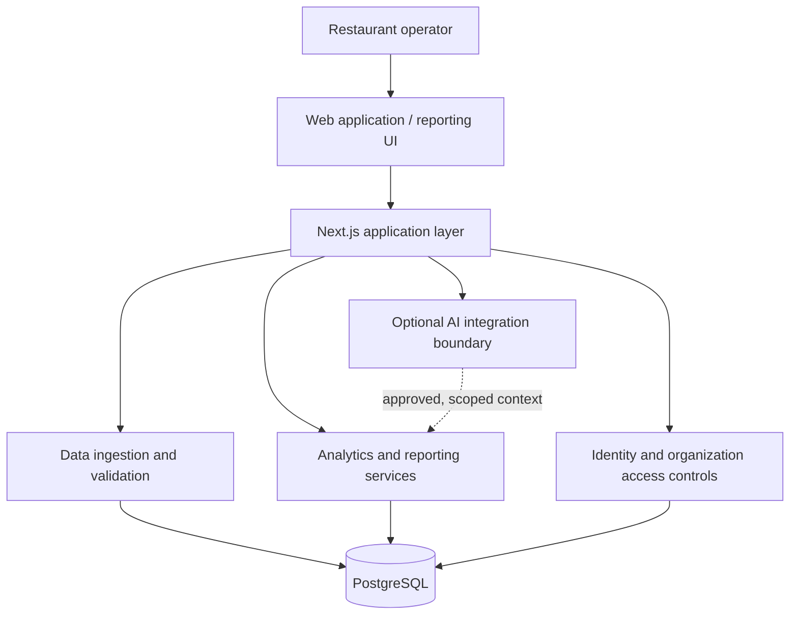

# ProfitPulse — SaaS Architecture Case Study

**Private-source product · Public engineering overview · Alec Agen**

ProfitPulse is a restaurant-focused business intelligence application intended to help operators interpret sales performance and identify opportunities for operational improvement. This repository describes the **software architecture and engineering practices** behind the project without releasing proprietary code, deployment details, customer data, or private infrastructure information.

> **Project status:** Application code and deployment-readiness tooling have been developed. A publicly accessible production deployment, live customer rollout, and production service-level performance are **not claimed** here. This is a portfolio case study, not an open-source distribution.

## Engineering overview

| Area | Technologies / approach |
| --- | --- |
| Application | Next.js 16, React, TypeScript |
| Data persistence | PostgreSQL, Drizzle ORM |
| Development infrastructure | Docker Compose for local PostgreSQL |
| Authentication | Better Auth; account and organization model |
| Data workflows | CSV ingestion, validation, business analytics and reporting |
| Integration design | Provider-oriented interfaces; integrations at different implementation stages |
| AI architecture | Provider-neutral integration boundary with mock-capable development workflow |
| Quality controls | Vitest, ESLint, TypeScript, GitHub Actions |
| Release engineering | Schema migrations, environment validation, secret scanning, release checks |

**My role:** Product planning, systems architecture, implementation, development environment setup, technical decision-making, and engineering validation. This project is independently developed, with development tools and AI assistance used as appropriate.

## Simplified application architecture

*Conceptual diagram: intentionally excludes source-level logic, service URLs, infrastructure topology, credentials, internal API paths, and database schemas. It is not a claim that every integration is live.*

## What the design demonstrates

- **Full-stack ownership:** Application UI, server-side behavior, data persistence, and domain-oriented workflows.
- **Multi-organization design:** Account and organization boundaries inform authorization and data access.
- **Data engineering:** Input validation, structured imports, reporting periods, and reproducible demonstration datasets.
- **Maintainability:** Separation of application features from reusable authentication, data, and integration concerns.
- **Software delivery:** Automated checks and release-readiness workflows support controlled changes.
- **Operational awareness:** Health/readiness contracts, logging/observability boundaries, and deployment runbooks exist in the private implementation; live hosting is not implied.

## Detailed case studies

- [Application and data architecture](docs/application-architecture.md)
- [Security and privacy engineering](docs/security-and-privacy.md)
- [Testing, CI, and release readiness](docs/software-delivery.md)
- [Public disclosure boundaries](docs/disclosure-policy.md)

## Private-source disclosure

**The application source is private.** This public repository includes only original, high-level explanatory documentation and diagrams.

No source code, environment files, customer information, detailed schema, credentials, IP addresses, hostnames, internal URLs, production configuration, or unpublished commercial roadmap are provided. Architecture is intentionally abstracted so the case study can be discussed during technical interviews without exposing implementation IP.

**Contact / discussion:** Architecture, design trade-offs, software delivery processes, and lessons learned can be discussed at a high level in an interview.
