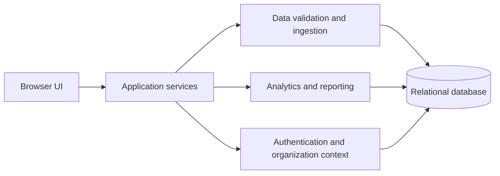

# Application and data architecture

## Design context

ProfitPulse is a data-oriented SaaS project serving restaurant operations and reporting workflows. It combines a web application, organization-aware access, ingestion workflows, persistent data, and analytics-oriented features.

## Logical layers

The diagram intentionally abstracts away routes, modules, database tables, and source structure.

## Data lifecycle (conceptual)

1. Data is introduced through supported input workflows, including CSV import.
2. Validation guards input quality before persistence and downstream processing.
3. The application stores structured data associated with an organization context.
4. Analytics and reporting features transform authorized data into operational summaries.
5. Demonstration data can exercise the product without relying on actual customer records.

This is an architectural summary, **not** a publication of ingestion algorithms, relational schemas, or customer dataset formats.

## Technology decisions

- **Next.js and TypeScript:** Share a typed application development environment across UI and server-side behavior.
- **PostgreSQL:** Relational persistence for structured business data.
- **Drizzle ORM and migrations:** Manage application/database evolution alongside source changes.
- **Docker Compose:** Provide a consistent local database dependency.
- **Modular provider boundaries:** Reduce tight coupling between application logic and external integration providers.

## Integration maturity

CSV-based intake is part of the application workflow. Other POS and service integrations are at varying stages of implementation and planning; this case study does not claim production connectivity or active external credentials.

## Architecture boundaries

Exact source code, schemas, deployment configurations, table counts, integration protocols, internal endpoint names, and performance figures are intentionally excluded.
