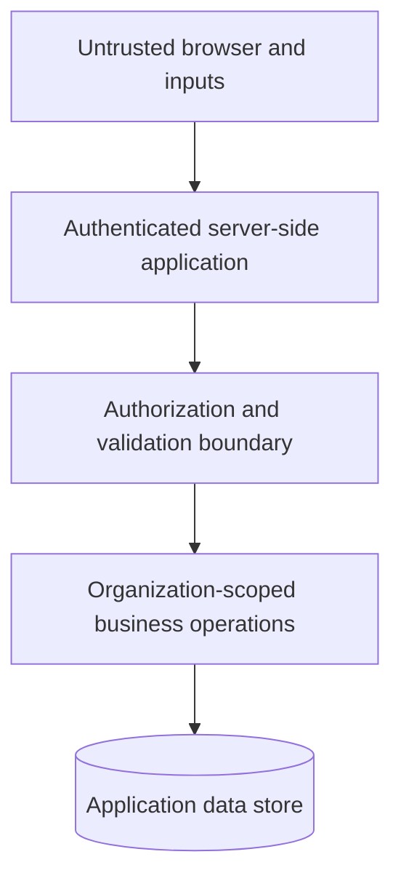

# Security and privacy engineering

This document describes security-oriented **design practices** in the private ProfitPulse codebase; it is not a certification, penetration-test report, or representation of production security operations.

## Security architecture themes

- **Identity and session handling:** Authentication is separated from application business functions.
- **Organization-aware authorization:** Data access depends on the authenticated user's organization membership and active context.
- **Server-side enforcement:** Protected application functions recheck relevant identity and organization conditions; client-side navigation is not treated as the security boundary.
- **Input validation:** Application inputs are validated before processing.
- **Environment hygiene:** Configuration validation and secrets checks are part of the release workflow.
- **Provider boundaries:** External services are integrated through application interfaces, allowing provider configuration to remain outside published artifacts.

## Simplified trust boundary

The diagram explains security responsibilities without exposing actual policies, route names, credential management details, or database access patterns.

## Privacy and disclosure controls

This public portfolio contains:

- No real user, employee, restaurant, or customer data
- No private source code or operational configuration
- No IP addresses, private hostnames, live URLs, internal API routes, or network topology
- No credentials, secrets, encryption keys, or authentication tokens
- No detailed database schema or proprietary scoring logic

## Not claimed

No security certification, independent penetration test, verified production isolation, regulatory compliance assessment, or live incident-response capability is claimed here.
