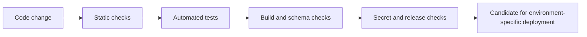

# Software delivery, testing, and release readiness

## Engineering workflow

The private application includes tooling for automated validation and controlled database evolution.

*This is a conceptual quality-gate sequence, not an exact copy of the private CI pipeline.*

## Practices represented in the codebase

| Discipline | Example approach |
| --- | --- |
| Static analysis | TypeScript and ESLint |
| Automated tests | Vitest test suite |
| Continuous integration | GitHub Actions checks |
| Database lifecycle | Drizzle-managed migration workflow and schema verification |
| Local development | Docker Compose-backed PostgreSQL |
| Configuration safety | Environment-specific validation before release |
| Secrets hygiene | Pattern-based secret scanning |
| Deployment preparation | Separate staging and production checklists, migration gates, smoke-check tooling |
| Runtime readiness | Health/readiness endpoints and observability abstraction |

## Deployment status matters

There is an important distinction between **deployable software** and **a verified operational service**.

The private project documentation describes staging-ready code and deployment runbooks. It does not establish a running staging or production environment, successful external delivery-provider validation, a production recovery exercise, or active paying customers.

This distinction is intentional: release engineering includes clearly defining what must be checked *after* application code passes automated gates.

## Lessons demonstrated

- Keep database changes versioned and independently verifiable.
- Run repeatable checks rather than rely solely on manual testing.
- Fail closed on incomplete environment configuration.
- Separate code completion from operational deployment approval.
- Treat documentation and rollback preparedness as software-delivery responsibilities.

No private CI configuration, deploy commands, hostnames, or secret identifiers are published here.
